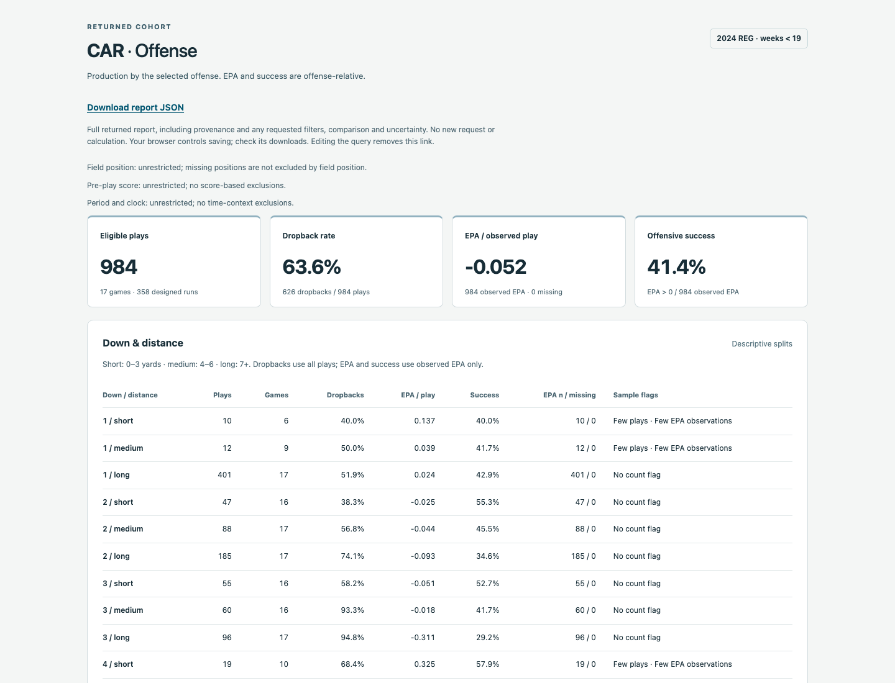
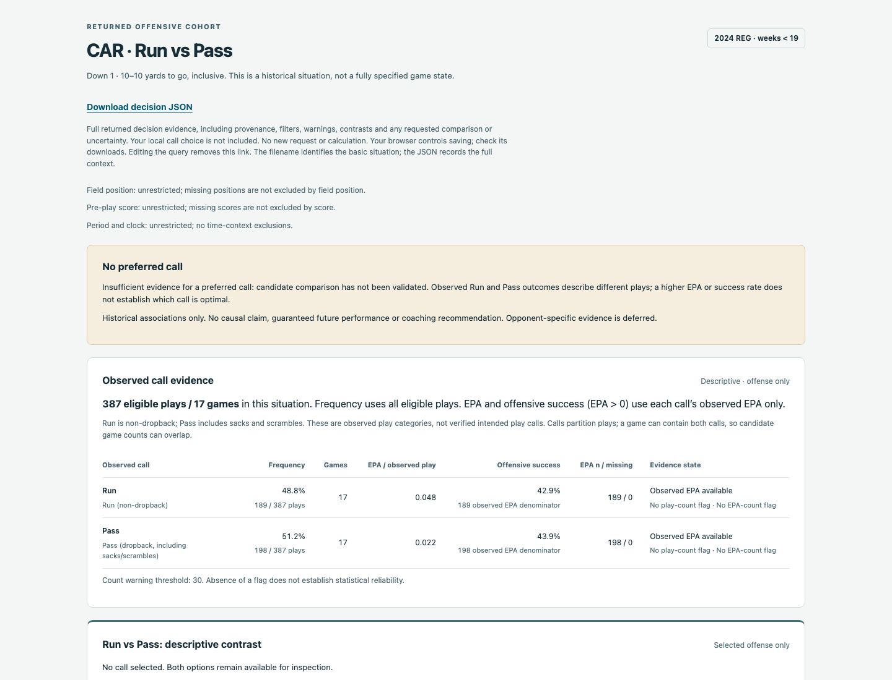
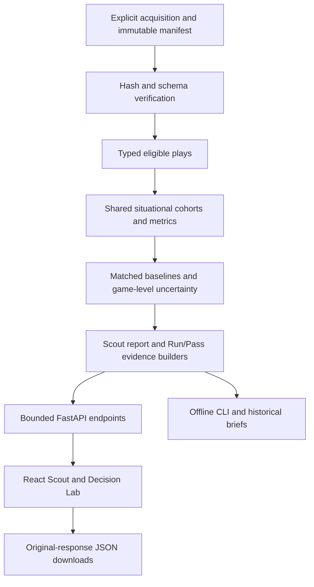

# NFL Decision Intelligence

**What did an NFL team do in this situation, how did those plays turn out, and
how much evidence supports the comparison?**

A personal local portfolio project by Aryan Parte. Explore historical NFL
play-by-play in **Scout**, or compare observed **Run vs Pass** evidence in
**Decision Lab**. One verified data pipeline powers both modes, a FastAPI service
and a React/TypeScript interface. No NFL or team affiliation is claimed.

**Local portfolio v1: complete.** Clone, run, inspect and reproduce the evidence.
This is a bounded local application; public hosting, live-data operations and
additional models are optional future work. The [completion record](docs/STATUS.md)
and [roadmap](ROADMAP.md#p110--local-portfolio-finish-line) define the finish line.
Further development requires Aryan's explicit request.

## Two ways to explore the evidence

| Mode | Football question | What you can inspect |
| --- | --- | --- |
| **Scout** | How did this offense behave, or what did this defense allow? | Tendencies, EPA/play, success, down/distance splits, situational filters, matched league context and game-level uncertainty. |
| **Decision Lab** | What happened on Run and Pass in this offensive situation? | Call frequency, outcomes, per-candidate league baselines, sample support, your own call annotation and downloadable evidence. |

Decision Lab always withholds a preferred call. Historical Run and Pass occurred
on different plays; their averages do not establish which call would be optimal.



*Scout: actual local UI, CAR offense, 2024 REG, weeks before 19. The
[historical brief and saved report](docs/examples/car-2024-reg-before-week-19.md)
retain the full league comparison, uncertainty and source provenance.*



*Decision Lab: the same snapshot and cutoff, exact first-and-ten. Both screenshots
were captured from the application, using real retrospective data. See the
[three-case walkthrough](docs/CASE_STUDY.md) for exact inputs, downloads and limits.*

## Run locally

Use **Python 3.11–3.13**, **Node 24.19.0** (`web/.nvmrc`) and macOS/Linux
(or WSL on Windows). From a terminal:

```sh
git clone https://github.com/AryanParte/nfl-opponent-intelligence.git
cd nfl-opponent-intelligence
python3 -m venv .venv/local
.venv/local/bin/python -m pip install -c requirements/api-constraints.txt '.[api]'
npm --prefix web ci
```

Choose an existing immutable snapshot, or explicitly acquire one once:

```sh
PYTHONPATH=src .venv/local/bin/python -m opponent_intelligence.fetch --season 2024
```

Use the directory printed by that command and the acquisition date in its manifest:

```sh
.venv/local/bin/python scripts/start_local.py \
  --snapshot '/absolute/path/to/your/immutable-snapshot-directory' \
  --source-label 'nflverse 2024 retrospective snapshot; acquired YYYY-MM-DD UTC'
```

After **Ready**, open **http://127.0.0.1:5173/**. **Ctrl-C stops both services.**
Installation and first acquisition need network access; ordinary startup and
reporting use local data. No raw NFL season files are committed. A new upstream
revision may differ from the pinned examples; do not relabel it as the old snapshot.

[Setup, troubleshooting and cleanup](docs/LOCAL_START.md) explain the exact paths.
The [API container](docs/CONTAINER.md) is an optional local alternative. For a
zero-network introduction without API/frontend packages, use the labeled synthetic
[CLI walkthrough](docs/CLI_GUIDE.md#try-it).

## Three retrospective examples

The [case study](docs/CASE_STUDY.md) follows one immutable 2024 snapshot:

1. **CAR's season in Scout:** 984 eligible plays across 17 games; EPA/play −0.052
   versus +0.011 for the pooled other offenses. Read the denominator and context
   before interpreting the difference.
2. **First-and-ten in Decision Lab:** 189 Run and 198 Pass plays. Run EPA/play
   +0.048 and Pass +0.022 describe different observed plays; the app abstains from
   ranking either call.
3. **Third-and-four before week 10:** only 13 plays. Run's three supporting games
   are insufficient for an EPA interval. The small sample is part of the result.

Each has exact settings, saved JSON, source hashes and a replay path. These are
illustrations of analysis and evidence limits, not backtested coaching policies.

## Architecture and engineering choices



- **Reproducible inputs:** content hashes, immutable acquisition manifests,
  attribution, explicit season/week boundaries and ordered exclusion accounting.
- **Shared calculations:** standard-library Python core; optional API dependencies.
  React validates and presents results without calculating football statistics.
- **Honest evidence:** distinct play/EPA/game denominators, missing versus zero,
  matched leave-team-out baselines and withheld intervals when support is inadequate.
- **Bounded local service:** one configured read-only snapshot, bounded expensive
  options and one active builder. No per-request paths or data downloads; no
  database is needed for this access pattern.
- **Testable behavior:** offline synthetic edge cases, independently calculated
  raw-data checks, real API-to-browser flows, stale-response handling and native
  download checks. CI covers core/API Python versions, frontend type/build,
  Chromium integration and the optional API container.

[Implementation map and detailed commands](docs/CLI_GUIDE.md#how-the-code-fits-together),
[architecture decisions](docs/DECISION_INTELLIGENCE.md) and
[current verification receipts](docs/STATUS.md) connect those choices to code.
For a core-only check: `PYTHONPATH=src python3 -m unittest discover -s tests -v`.
Frontend/API/browser instructions are in [WEB.md](docs/WEB.md) and [API.md](docs/API.md).

## What the numbers mean—and do not mean

Run is an eligible non-dropback; Pass includes sacks and scrambles. These are
observed categories, not verified intended play calls. Kneels, spikes, conversion
attempts and no-play rows are excluded under the [data contract](docs/DATA_CONTRACT.md).
Success means **EPA > 0**, not a down/distance conversion rule. EPA and success
use observed EPA only; frequency uses all eligible plays in the selected cohort.

EPA comes from the upstream model. This project verifies handling and arithmetic,
not that model's causal or predictive validity. The examples were acquired in
2026, so a 2024 week cutoff does not prove what data or model versions were
available in 2024. Baselines pool other teams' plays under matching filters;
they are not opponent-adjusted predictions. Game-bootstrap intervals are
exploratory, with uncalibrated coverage and explicit support warnings.

No preferred-call, causal-optimality, guaranteed-performance or coaching claim is
made. Richer play families, opponent-specific ranking, fourth-down models and
tracking are deferred. Browser tests and a bounded accessibility review do not
constitute cross-browser, assistive-technology or WCAG certification.

Read the [metrics](docs/METRICS.md), [uncertainty method](docs/UNCERTAINTY.md),
[Run/Pass policy](docs/DECISION_POLICY.md), [source terms](docs/INGESTION.md) and
[learning log](LEARNING_LOG.md). The detailed research and future ideas remain
available; they are not unfinished requirements for this local v1.
