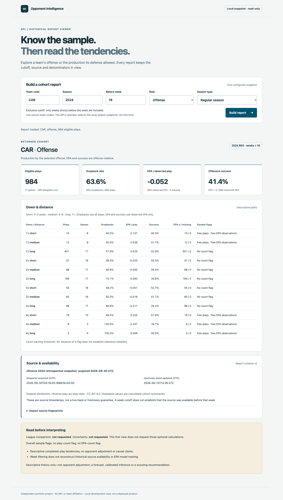

# CLI and detailed implementation guide

These are the detailed commands and code map preserved from the original README.
Run shell commands from the repository root. For the simplest Scout + Decision Lab
startup, use [LOCAL_START.md](LOCAL_START.md); for a short real-data walkthrough,
use [CASE_STUDY.md](CASE_STUDY.md). Synthetic examples are labeled below.

## Try it

Requires Python 3.11 or later. The core runtime and core tests use only the standard
library; the following commands need no package installation or network access.
Run them from the repository root:

```sh
PYTHONPATH=src python3 -m unittest discover -s tests -v

PYTHONPATH=src python3 -m opponent_intelligence \
  --csv tests/fixtures/synthetic_pbp.csv \
  --source-label 'Synthetic verification fixture; not real NFL observations' \
  --team CAR --season 2024 --before-week 3
```

The fixture is entirely invented. Team abbreviations illustrate the schema; its
numbers make no statement about any real team. The command describes weeks 1–2
of the chosen season; week 3 and later, other offenses, and playoff rows are
excluded. It produces these hand-checkable totals:

| Output | Synthetic result |
| --- | ---: |
| Eligible cohort plays / games | 6 / 2 |
| Dropbacks / designed runs | 3 / 3 |
| Dropback rate | 50% |
| Observed / missing EPA | 5 / 1 |
| EPA per observed play | 0.04 |
| Success rate among observed EPA | 60% |

JSON also includes down/distance splits, all input exclusion counts, the exact
input SHA-256, and warnings. Empty rates are `null`. Invalid schema, malformed
values, unknown play types, and duplicate play identities cause an error rather
than silent repair. Recognized missing play types are excluded with a separate
audit count; see the [input contract](DATA_CONTRACT.md).

### Select the defense

`--side offense` is the default. To describe the offenses facing a selected defense:

```sh
PYTHONPATH=src python3 -m opponent_intelligence \
  --csv tests/fixtures/synthetic_pbp.csv \
  --source-label 'Synthetic verification fixture; not real NFL observations' \
  --team ATL --side defense --season 2024 --before-week 3
```

This invented example contains five plays, three dropbacks, and four observed EPA
values: 0.05 EPA/play and 75% offensive success allowed. EPA is **not sign-flipped**;
success still means offensive EPA > 0, not defensive stops. Down/distance describes
the opposing offense. Denominator rules, missing-data handling, and the exclusive
week cutoff are unchanged.

Reports now use JSON schema v2: `cohort.team` and `cohort.side` replace
`cohort.offense`, with explicit `metric_context`. Existing commands still default
to offense and retain the same measurements, but JSON consumers must migrate;
see [schema and interpretation](METRICS.md#report-schema-v2).

### Compare with other teams

Add `--compare-league` to include a pooled baseline excluding the selected team
in the same role. This example is entirely synthetic and still needs no network:

```sh
PYTHONPATH=src python3 -m opponent_intelligence \
  --csv tests/fixtures/synthetic_pbp.csv \
  --source-label 'Synthetic verification fixture; not real NFL observations' \
  --team CAR --season 2024 --before-week 3 --compare-league
```

The invented baseline has just one ATL offensive play with EPA 3, compared with
CAR's six plays and EPA/play 0.04: the difference is -2.96. Its tiny sample warning
is intentional; this fixture is not league coverage or evidence about either team.

Both populations use the same season/type, exclusive week cutoff, and requested
field/score/period/clock filters. Each selected down/distance bucket gets its own
matching baseline; missing matches produce null differences, not a fallback to
the league-wide rate. Rate differences are **percentage points**, and EPA
differences remain offense-relative. Defense mode compares production allowed by
other defenses, without reversing EPA or success.

The JSON exposes observed baseline teams, play/game/EPA counts, missingness,
shared games, and selected-minus-baseline differences. It pools individual plays,
not team averages; overall context mixes may still differ. No comparison is added
unless requested. See the [comparison contract](METRICS.md#matched-league-baselines)
and [real-data verification](REAL_DATA_AUDIT.md#league-baseline-extension-2026-10-05).

### Check game-level support and uncertainty

Add `--bootstrap-repetitions 1000 --bootstrap-seed 0` for reproducible whole-game
resampling. With comparison enabled, both populations use the same game draws:

```sh
PYTHONPATH=src python3 -m opponent_intelligence \
  --csv tests/fixtures/synthetic_pbp.csv \
  --source-label 'Synthetic verification fixture; not real NFL observations' \
  --team CAR --season 2024 --before-week 3 --compare-league \
  --bootstrap-repetitions 1000 --bootstrap-seed 0
```

The invented fixture has only two selected games and one baseline game: its
overall intervals are deliberately `null` with `insufficient_games`, while existing
point estimates remain available. More resamples cannot fix insufficient observed games.
Supported cohorts can have nominal 95% percentile intervals, but these are
exploratory—not calibrated coverage, significance tests, or predictions. Reports
show per-metric game support, undefined draws, small-game warnings, and degenerate
interval states. See the [method and JSON contract](UNCERTAINTY.md), including
the limits of repeated teams/opponents across games.

### Read a historical opponent brief

Open the [synthetic brief](examples/synthetic.md) or the
[retrospective CAR offense example](examples/car-2024-reg-before-week-19.md).
The latter summarizes 984 eligible plays across 17 games from the pinned 2024
snapshot, acquired in 2026—not a forecast or a historically available 2024 scouting
report. Both include source fingerprints, denominators, matching baselines,
unavailable intervals, few-game warnings, and interpretation limits.

Replay the committed aggregate JSON without downloading raw data:

```sh
PYTHONPATH=src python3 -m opponent_intelligence.brief \
  --report docs/examples/car-2024-reg-before-week-19.report.json
```

Or pipe a newly generated synthetic report directly into the renderer:

```sh
PYTHONPATH=src python3 -m opponent_intelligence \
  --csv tests/fixtures/synthetic_pbp.csv \
  --source-label 'Synthetic verification fixture; not real NFL observations' \
  --team CAR --season 2024 --before-week 3 --compare-league \
  --bootstrap-repetitions 200 --bootstrap-seed 0 \
  | PYTHONPATH=src python3 -m opponent_intelligence.brief --report -
```

Markdown goes to stdout; existing JSON commands are unchanged. Invalid saved
reports fail before any brief is printed. See the [brief contract and replay
instructions](BRIEFS.md), including what a fingerprint does **not** prove.

### Personnel and motion: known limits

The pinned PBP snapshot has neither personnel nor motion columns. The
[availability and licensing audit](PERSONNEL_MOTION.md) records the direct
fields, unsuitable proxies, separately documented sources, and a replayable
offline inventory. It also explains why data published after a season cannot be
assumed available during that season. No personnel or motion rate is exposed by
the current reports. A separate [FTN snapshot audit](FTN_CHARTING_AUDIT.md) has
now acquired one reviewed 2024 artifact. Its [PBP join and coverage audit](FTN_COVERAGE.md)
is complete, with explicit unknown/invalid field counts. The [admission decision](FTN_FIELD_POLICY.md)
defers charting rates, filters and play families until measurement/denominator rules
are validated. No supplementary source is consumed by the existing reports.

## Acquire a reproducible raw snapshot

The optional acquisition command downloads the reviewed 2024 nflverse gzip CSV,
checks the published digest, and saves an immutable snapshot with a provenance
manifest. Its first run requires network access; subsequent runs verify the cache
offline. Explicit `--refresh` acquires changed upstream bytes without overwriting
older snapshots. Raw data stays out of Git.

```sh
PYTHONPATH=src python3 -m opponent_intelligence.fetch --season 2024
```

[Acquisition, attribution, and verification evidence](INGESTION.md) explains
the cache. Use the explicit snapshot directory printed by acquisition to audit or
report offline; neither command fetches data or follows the mutable cache pointer:

```sh
snapshot_dir=data/raw/nflverse/pbp/2024/23370d5d10f8104d80d46a1fc5e61f4f6f5a3263fe96fe2dd629913cfcb08c06
PYTHONPATH=src python3 -m opponent_intelligence.audit --snapshot "$snapshot_dir"
PYTHONPATH=src python3 -m opponent_intelligence \
  --snapshot "$snapshot_dir" \
  --source-label 'nflverse 2024 retrospective snapshot; acquired 2026-09-30 UTC' \
  --team CAR --season 2024 --before-week 3
```

This pinned example requires the recorded snapshot to be present. If upstream has
changed, a fresh acquisition produces a different directory; do not relabel it as
this snapshot. [Real-data audit and limits](REAL_DATA_AUDIT.md) records the
49,492-row reconciliation and independently checked cohort denominators.
Snapshot reports include the source manifest and both byte fingerprints.
`--csv` remains the uncompressed, caller-labeled path; the synthetic demo stays
independent of GitHub availability and credentials.

### Limit field position

Using that same pinned snapshot, select plays where opposing offenses faced CAR
at or within 20 yards of CAR's goal line:

```sh
PYTHONPATH=src python3 -m opponent_intelligence \
  --snapshot "$snapshot_dir" \
  --source-label 'nflverse 2024 retrospective snapshot; acquired 2026-09-30 UTC' \
  --team CAR --side defense --season 2024 --before-week 3 \
  --yardline-min 0 --yardline-max 20
```

Bounds are inclusive and use the offense's `yardline_100` coordinates for either
side. Omit one bound to use 0 or 100; omit both to leave the cohort unfiltered.
Missing positions are excluded only when filtering, with explicit counts and a
warning. Filtering requires the source column, even for an otherwise empty cohort.
The original synthetic fixture omits it intentionally; the offline field-position
tests generate separate synthetic inputs. See [definitions](METRICS.md#pre-play-field-position-ranges)
and the [real-data check](REAL_DATA_AUDIT.md#field-position-extension-2026-10-02).

### Limit the pre-play score

Select CAR offensive plays while trailing, within 20 yards of the opposing goal
line, using the same pinned snapshot:

```sh
PYTHONPATH=src python3 -m opponent_intelligence \
  --snapshot "$snapshot_dir" \
  --source-label 'nflverse 2024 retrospective snapshot; acquired 2026-09-30 UTC' \
  --team CAR --season 2024 --before-week 3 \
  --yardline-max 20 --score-max -1
```

`--score-min` / `--score-max` are inclusive whole-point bounds on pre-play
`score_differential` (offense minus defense). One omitted end is unbounded; omit
both for no score filter. Use `--score-min 0 --score-max 0` for ties, or
`--score-min 1` for an offense leading. For `--side defense`, the sign still refers
to the **opposing offense**, not the selected defense. Post-play scores are never
used as a substitute.

These optional filters exclude unknown context only when requested. Field position
runs first, then score, with explicit order and separate before/missing/outside/
after counts so overlaps are not counted twice. This example selects seven plays
from two games; it is a retrospective software check, not a scouting conclusion.
See [score semantics](METRICS.md#pre-play-score-ranges) and
[reconciliation evidence](REAL_DATA_AUDIT.md#score-extension-2026-10-03).

### Select a period and pre-play clock

Select CAR offensive plays starting with at most 120 seconds left in Q4:

```sh
PYTHONPATH=src python3 -m opponent_intelligence \
  --snapshot "$snapshot_dir" \
  --source-label 'nflverse 2024 retrospective snapshot; acquired 2026-09-30 UTC' \
  --team CAR --season 2024 --before-week 3 \
  --period Q4 --clock-max 120
```

`--period` accepts `Q1`, `Q2`, `Q3`, `Q4`, or `OT` (all overtime periods).
Clock bounds are inclusive whole seconds remaining **at the start of the play**,
not elapsed time or the end-of-play clock. An explicit period is required with
`--clock-min` / `--clock-max`; one omitted end defaults to 0 or 900. Zero is valid.
Period-only selection does not require an observed clock. With neither period nor
clock flags, previous output is unchanged.

The example excludes OT; it is not a "last two minutes of the game" definition.
An OT range applies separately within each overtime period, not to cumulative
overtime elapsed time. Field/score filters can be combined: selection order is
field position → score → period → clock, after team/season/week selection. Missing
context is excluded only by its requested filter, with separate counts/warnings.
Absent required source columns are errors, not empty results. The original fixture
has no time columns; clock tests generate explicitly synthetic inputs. See
[clock semantics](METRICS.md#pre-play-period-and-clock) and
[pinned-snapshot evidence](REAL_DATA_AUDIT.md#clock-extension-2026-10-04).

## Serve Scout and Decision evidence locally (optional)

A [pinned API-only container](CONTAINER.md) is also available for Linux amd64
and arm64, using a non-root single worker and an explicitly mounted read-only
snapshot. It serves these same endpoints; the local viewer still runs separately.

The first product endpoint is `GET /v1/report`. It loads one explicitly configured
immutable snapshot at startup and reuses the analytical builder; requests cannot
choose paths, refresh data or trigger downloads. API dependencies are optional.
See [setup, query bounds, error contract and replay](API.md) before starting
the service on loopback. Example query once it is running:

```sh
curl 'http://127.0.0.1:8000/v1/report?team=CAR&season=2024&before_week=19'
```

Responses retain schema v2, provenance, warnings, nulls, and opt-in comparison and
uncertainty. This is a local integration slice, not a public deployment. The core
CLI and synthetic demo above still need no web packages.

`GET /v1/decision` additionally requires exact down and inclusive distance bounds:

```sh
curl 'http://127.0.0.1:8000/v1/decision?team=CAR&season=2024&before_week=19&down=3&distance_min=4&distance_max=4&compare_league=true'
```

It returns Run/Pass contract v1, including candidate denominators, league context,
warnings and mandatory abstention from choosing a call. It is offense-only; `side`,
opponent, play-family and model options are unsupported. Optional bootstrap work
is capped at 1,000 repetitions and both routes share one active builder slot.
See the [Decision HTTP contract](API.md#decision-request-contract). This
response is separate from Scout schema v2 and its brief/download workflow.

### Open the local report viewer

Use the [one-terminal launcher](LOCAL_START.md) above. If you deliberately
run the API separately (including the optional container), start only the viewer
with `npm --prefix web run dev` after installing its locked dependencies. Do not
run a second API on the same port.

Open `http://127.0.0.1:5173/`, choose a cohort and select **Build report**.
[Setup, connection policy, screenshot and verification](WEB.md) explains the
narrow view. Optionally select **Compare with other teams in the same role** for
pooled baseline metrics and matched down/distance comparisons. Optional **Minimum /
Maximum yards to goal** fields apply an inclusive offense-relative range to both
populations. Both blank means no filter; an explicit 0–100 range excludes unknown
positions. The returned accounting separates missing, outside-range and retained
plays. Optional **Minimum / Maximum score difference** uses signed whole points
(offense minus defense before the play), with blank ends unbounded. Field position
is filtered before score, with separate accounting for each stage and population.
Optional **Period** selects Q1–Q4 or all overtime periods. **Minimum / Maximum
seconds remaining** require a period and accept inclusive whole seconds 0–900 at
play start; a blank end defaults to 0 or 900 when the other is entered. Both blank
means no clock filter, which can retain missing clocks. Filtering follows field
→ score → period → clock. Optional **Bootstrap repetitions** (200–1000) and **Bootstrap
seed** (0–4294967295, default 0) expose the existing exploratory game-level intervals.
Both blank means not requested; seed alone is invalid. Overall and matching
situation tables show support, defined/undefined draws and withheld intervals,
not calibrated confidence or predictions. **Download report JSON** saves the
current validated response, including every returned source/method field and
optional filter/comparison/uncertainty block. It makes no extra request; editing
clears the download link along with the report. See [download and offline replay](WEB.md#download-and-replay-the-current-report).
The view never acquires raw NFL data or
substitutes synthetic observations for an API failure. Snapshot timestamps are
visible, not mislabeled as a live-feed guarantee.



See the [comparison view and its interpretation limits](WEB.md#matched-league-comparison)
for observed coverage, signed differences and unavailable values, and the
[field-position view](WEB.md#pre-play-field-position),
[pre-play score view](WEB.md#pre-play-score-difference), and
[period/clock view](WEB.md#pre-play-period-and-clock) for bounds and exclusion counts.
The [uncertainty view](WEB.md#exploratory-game-level-uncertainty) explains
paired differences, distinct game support and why withheld bounds are not certainty.

## The football decision

The football question is: how often does an offense drop back in comparable situations, how effective are those plays, and
how much evidence supports each observation? Scout explores those historical
patterns; Decision Lab compares the Run/Pass evidence in a specific situation.

Dropbacks include sacks and scrambles. Kneels, spikes, conversion attempts, and
non-run/pass plays are excluded. Missing EPA still contributes to the play-call
denominator. [Metric definitions and limitations](METRICS.md) explain the
inclusion policy and why the current output is descriptive rather than a forecast.

## How the code fits together

1. `src/opponent_intelligence/pbp.py` validates a local CSV and records exclusions.
2. `src/opponent_intelligence/report.py` selects the historical cohort and computes
   totals and down/distance splits.
3. `src/opponent_intelligence/__main__.py` exposes the workflow as a JSON command.
4. `src/opponent_intelligence/fetch.py` and `snapshots.py` acquire and verify raw
   data separately from analytical reporting.
5. `ingestion.py` binds parsed gzip bytes to provenance; `audit.py` reconciles raw
   coverage, missingness, and eligible identities against the adapter.
6. `tests/test_pipeline.py` checks independently calculated results, malformed
   inputs, time boundaries, and command-line behavior.
   `tests/test_snapshots.py` tests acquisition and cache failure cases offline;
   `tests/test_ingestion.py` tests provenance, audit, and report integration.
   `tests/test_defense_reports.py` checks role selection, reciprocal measurements,
   denominator accounting, and unaltered EPA interpretation.
   `tests/test_field_position.py` checks optional-field validation, inclusive bounds,
   scoped missingness, legacy compatibility, and CLI failures.
   `tests/test_score_filters.py` checks signed whole-point bounds, pre/post-play
   separation, combined-filter accounting, reciprocal roles, and compatibility.
   `tests/test_clock_filters.py` checks period/clock bounds, OT separation,
   zero versus missing, four-stage accounting, and unchanged defaults.
   `tests/test_league_comparison.py` checks leave-team-out pooling, matching buckets,
   explicit difference units, independent population counts, and unavailable results.
7. `uncertainty.py` resamples shared whole games with optional support-aware intervals.
   `tests/test_uncertainty.py` checks all 3,125 resamples of a five-game synthetic
   example independently, plus missingness, support, pairing, and reproducibility.
8. `brief.py` renders saved JSON as deterministic Markdown; `brief_validation.py`
   checks the consumed schema and cross-field relationships. `tests/test_brief.py`
   covers units, support, unsafe text, invalid saved inputs, and byte-exact examples.
9. `availability.py` audits exact personnel/motion candidate columns offline,
   separating schema absence from missing observations and zero-valued indicators.
   `tests/test_availability.py` verifies counts, provenance and safe failure states.
10. Optional `api.py` loads a configured snapshot once and adapts bounded HTTP
    queries to `build_report` and `build_decision_evidence` using a shared work slot;
    `api_models.py` defines the separate transport contracts.
    `tests_api/test_api.py` exercises synthetic HTTP contracts without network;
    `tests_api/test_decision_api.py` covers candidate evidence and cross-route safety;
    `tests/test_optional_api.py` checks dependency-free CLI/decision-core isolation.
11. `web/src/App.tsx` presents the local cohort view; `web/src/report.ts` validates
    the consumed API contract and formats values without changing measurements.
    Frontend tests cover states/races/errors; `tests_api/test_frontend_contract.py`
    checks that committed synthetic browser fixtures match the actual endpoint.
12. `decision.py` defines the offline Run/Pass contract and matching candidate
    baselines using shared `cohort.py` selection and `metrics.py` summaries/differences.
    `tests/test_decision.py` and `tests/test_decision_league.py` check exact matching,
    interpretation, denominators, pooling, coverage and unavailable states.
    `tests/test_decision_uncertainty.py` checks candidate denominators/support and
    the shared resampler against all 3,125 draws of an invented five-game sample.
    Repository-only `validation/decision_audit.py` independently checks raw-record
    cohorts and expanded-game intervals; its synthetic/mutation tests run in CI.
    The real-snapshot receipt replays offline with the documented pinned inputs.
    `tests/test_decision_policy.py` checks descriptive contrast signs/units,
    missing states and the strict separation between arithmetic and ranking.

The pure analytical functions serve both the CLI and the optional FastAPI adapter.
The completed Scout and bounded Decision Lab views consume that API. Calculations
stay in Python; no database is required for this immutable local snapshot.
The reporting core has no database, runtime API dependency, or trained
model; only the explicit acquisition command contacts GitHub.

## Project records

- [Roadmap and next task](../ROADMAP.md)
- [Current engineering status](STATUS.md)
- [Daily learning log](../LEARNING_LOG.md)
- [Data contract and provenance](DATA_CONTRACT.md)
- [Raw snapshots, source terms, and acquisition evidence](INGESTION.md)
- [Real-season audit and cohort reconciliation](REAL_DATA_AUDIT.md)
- [Independent Run/Pass reconciliation and replay](DECISION_AUDIT.md)
- [Run/Pass comparison, abstention and opponent-evidence policy](DECISION_POLICY.md)
- [Metric definitions](METRICS.md)
- [Exploratory uncertainty method](UNCERTAINTY.md)
- [Historical brief format and examples](BRIEFS.md)
- [Personnel/motion availability and scope decision](PERSONNEL_MOTION.md)
- [FTN charting artifact, key inventory and admission limits](FTN_CHARTING_AUDIT.md)
- [FTN/PBP join coverage, field issues and source applicability limits](FTN_COVERAGE.md)
- [FTN field admission/defer decisions and tested PBP isolation](FTN_FIELD_POLICY.md)
- [One-terminal local setup and cleanup](LOCAL_START.md)
- [Optional local API contract and setup](API.md)
- [Pinned API container, localhost operation and verification](CONTAINER.md)
- [Local browser viewer and verification](WEB.md)
- [Bounded accessibility review and remaining coverage](ACCESSIBILITY.md)
- [Portfolio presentation plan](PORTFOLIO.md)
- [Contribution and review workflow](../CONTRIBUTING.md)
- [Daily sync, commit identity, and recovery](DAILY_WORKFLOW.md)

The GitHub Actions workflow is committed. Local verification and observed remote
CI results are recorded separately in the status and learning log.
