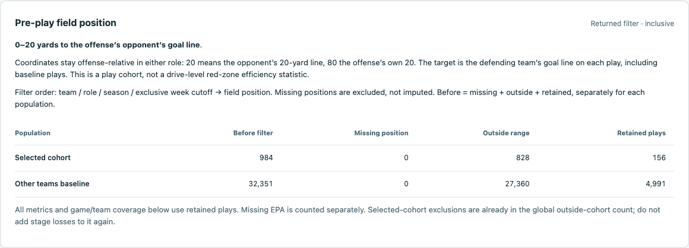
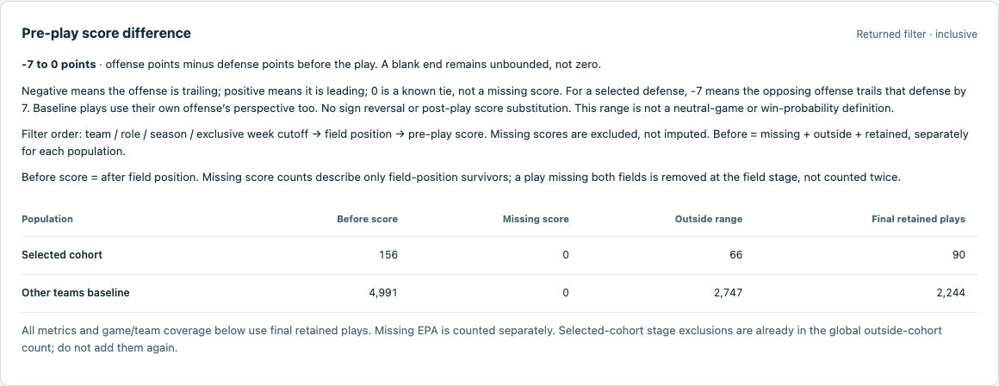
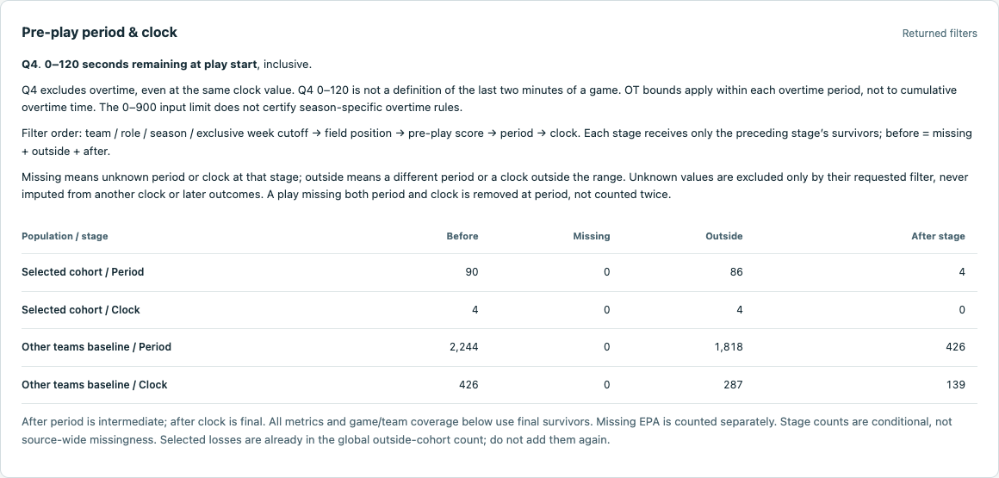
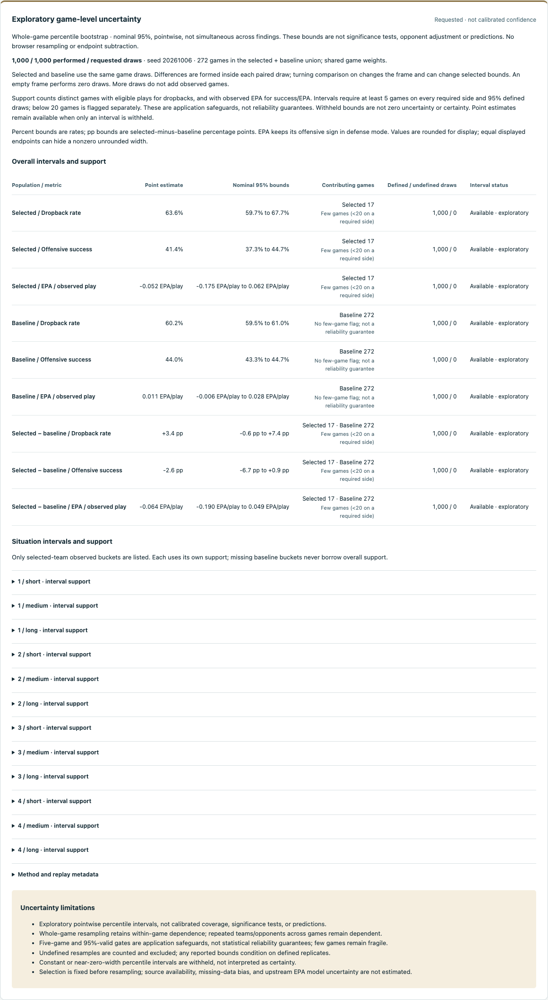
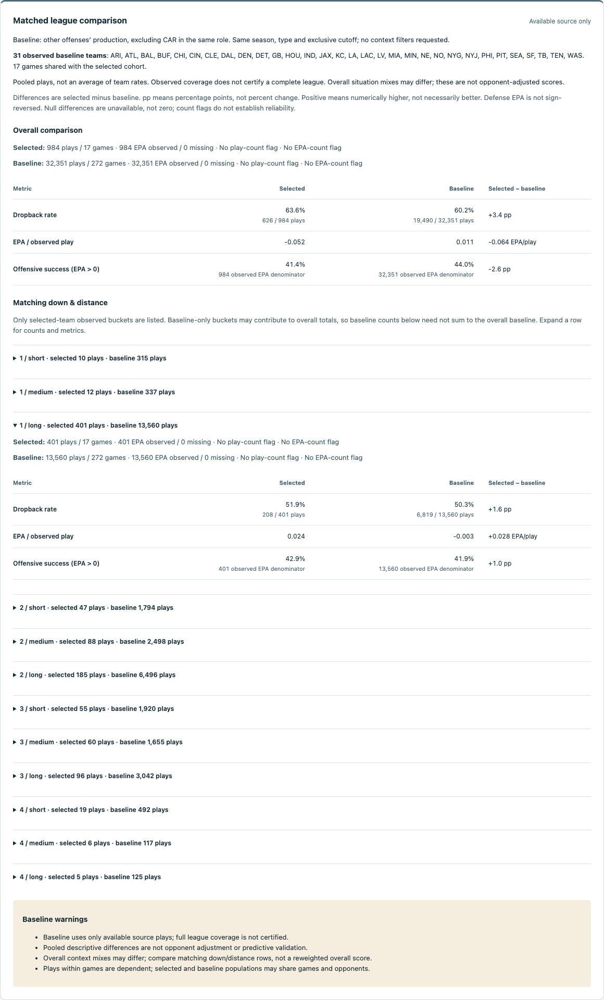

# Local report viewer

The first P1.4 browser slice is a React/TypeScript view of the existing
`GET /v1/report` endpoint, not a new analytics engine. It accepts team, season,
exclusive cutoff, offense/defense and regular/postseason selection. It displays
overall metrics, observed down/distance rows, sample flags, all report warnings,
source timestamps, attribution and fingerprints. An opt-in league comparison adds
observed baseline coverage, side-by-side measurements and matching situation differences.
Optional pre-play field-position and score bounds retain offense-relative
coordinates/signs; period/clock controls select Q1–Q4 or OT and inclusive seconds
remaining. All requested stages show ordered selected/baseline exclusion accounting.
Optional game-bootstrap controls expose returned exploratory intervals, per-metric
game support and withheld/undefined states without browser resampling.
The current validated response can be downloaded as JSON for offline brief replay,
retaining the API text and all returned metadata without another request.
It never selects a filesystem path, fetches NFL data, or silently falls back to a
synthetic response.


Screenshot captured from the real pinned snapshot via the local Vite proxy and
FastAPI service on 2026-10-09. This is retrospective CAR offense before REG week
19: 984 plays / 17 games, 626 dropbacks, -0.052 displayed EPA/play and 41.4%
displayed offensive success. Source acquisition was in 2026. This is not a live
feed, pregame-available dataset, performance benchmark or validated scouting advice.

## Start locally

Use Node **24.19.0** (`web/.nvmrc`) and Python 3.11–3.13. The frontend currently
supports Node 24.15+ within major 24; project-local engine enforcement rejects
unsupported versions. No global Node/npm settings are modified. Install/select
the runtime with your normal version manager, then check `node --version`.

First start the API using [the existing snapshot setup](API.md#install-and-start)
in one terminal. Its explicitly configured snapshot must already exist. Keep the
API on `127.0.0.1:8000`; the canonical pinned snapshot is still the example in that
guide, not a guarantee that today's upstream bytes match it.

In a second terminal, from the repository root:

```sh
cd web
npm ci
npm run dev
```

Open `http://127.0.0.1:5173/`, optionally check **Compare with other teams in the
same role**, and select **Build report**. Installation needs package
network access. Once dependencies and the snapshot exist, normal operation is
local: no hosted assets, remote fonts, acquisition or background report requests.
Stop the two terminal processes with Ctrl-C when finished.

The UI starts with CAR / 2024 / before week 19 / offense / REG as editable
example controls, not preloaded observations. A different configured season
returns an explicit API error until the controls match. Source codes are not
validated against a team registry: an absent but syntactically valid team can
produce an empty cohort, not proof of a real team.

## Local connection decision

Browser requests are same-origin `/api/v1/report?...`. Vite proxies only that exact
route to the fixed loopback API and strips `/api`. No client-selected backend URL,
general proxy, environment-based remote target, API CORS change or storage layer
was needed. Vite binds loopback on a fixed port, refuses port fallback and restricts
its asset allowlist to `web/`, not the surrounding repository/raw snapshots.

This is a **development** connection policy. Vite's build emits static assets, but
those files alone do not provide an API proxy. There is no production hosting
configuration, preview-server workflow, authentication or deployment in this unit.
Do not run either service on a public interface or override the localhost/file
restrictions as a deployment shortcut. Query limits are not a security boundary
for an internet-facing application. The existing single-snapshot, memory-resident
API does not justify adding a database for this view.

## Display and request contract

- Only the five basic query controls, optional `compare_league=true`, entered
  `yardline_min` / `yardline_max`, `score_min` / `score_max`, and explicit `period`
  with any entered `clock_min` / `clock_max` bounds, and entered
  `bootstrap_repetitions` / `bootstrap_seed` are sent.
  Comparison starts off and is omitted when unchecked. The API's default warning
  threshold remains 30. Bootstrap starts off; repetitions explicitly opt in.
  Unrequested calculations are labeled **not requested**, not zero,
  unavailable confidence, or evidence of no difference.
- The decoder checks the consumed schema v2 fields, returned cohort against the
  submitted query, offense-relative interpretation, metric shapes/count partitions,
  observed situation partitions, source hash consistency and UTC timestamps. Both
  `Z` and `+00:00`, including fractional seconds, are accepted. Unrequested filters
  or uncertainty blocks fail closed rather than being mislabeled or silently
  hidden. Comparison must be present if requested and absent otherwise. Its
  population/cohort/ledger and bucket identities are validated before display;
  difference arithmetic is checked against the returned estimates with 1e-9
  absolute tolerance, then the API's values are rendered. This is not a full
  independent source validator or a statistical reimplementation.
- EPA keeps its sign in defense mode, where production is **allowed to opposing
  offenses**. Success remains offensive EPA > 0, not defensive stops. Dropback
  rates use all eligible plays; EPA and success use observed EPA only. Small-count
  flags are warnings, not significance or independence guarantees.
- Nulls display as **Unavailable**; observed zeroes remain zero. Percentages are
  rounded to one decimal and EPA to three for display only. The API values are not
  rounded or recomputed. Differences use unrounded API values; subtracting rounded
  cells can differ in the last digit. A whole report may have observed EPA while an
  individual situation has none. Empty responses preserve provenance and warnings.
- Editing any control immediately removes old results and aborts the prior
  client request. A sequence guard also ignores late responses. Loading is
  announced, duplicate submit buttons are disabled, failures offer a manual retry,
  and a 15-second client timeout stops waiting. There are no automatic retries or
  refreshes. Client abort/timeout does **not** cancel the server's report builder.
- Local network/proxy failures, API busy/season errors, unreadable JSON and invalid
  responses have distinct visible feedback. Arbitrary server exception text is
  not echoed. Source labels and warnings render as text, not HTML/Markdown.
- Labels, native inputs, visible keyboard focus, a skip link, live status/alert
  regions, table headers/caption and a keyboard-focusable horizontal table support
  basic accessibility. This is not a screen-reader or WCAG conformance audit.

All detailed source/method/data-quality fields remain available in the downloadable
API JSON; this view intentionally summarizes a subset. No down/distance selectors,
interval charts or saved-query management exist yet.

## Download and replay the current report

After **Build report** succeeds, **Download report JSON** offers the same response
shown on screen. It is an aggregate report, not raw play-by-play. The browser
controls whether/where to save and may adjust the filename; check its downloads.
The viewer does not claim a click means a file was successfully saved.

The suggested name, for example
`nfl-oi-CAR-2024-REG-offense-before-week-19.report.json`, uses only the validated
returned team/season/type/role/exclusive cutoff. No source label, URL, path or
live draft input enters it. This is a **basic cohort label, not a unique report
identifier**: different filters, seeds, snapshots or comparison settings can share
the same suggested filename. Inspect the full cohort, method and source fields
inside the JSON (and the renderer's fingerprint) to distinguish them.

The decoder now retains both its validated report object and the original decoded
JSON response text. The download is a UTF-8 `application/json` Blob of that text,
not a `JSON.stringify` of the parsed object or a subset of displayed fields.
Thus unrendered source/method fields, whitespace, numeric spellings, optional
contexts, comparison/uncertainty, warnings, nulls and unrounded values survive.
JavaScript reserialization can turn `1.0` into `1` or round a large integer,
changing the Python brief fingerprint even when displayed measurements agree.
This preserves decoded JSON text, not HTTP headers or compressed transport bytes.
Validation still covers the viewer's consumed contract, not every unknown field.

There is no additional report request, raw-data acquisition, bootstrap run or
browser analytics. A [native download link](https://developer.mozilla.org/en-US/docs/Web/API/HTMLAnchorElement/download)
owns one live object URL per displayed document and is keyboard-usable; repeated
clicks reuse it. Following the [blob URL lifetime guidance](https://developer.mozilla.org/en-US/docs/Web/URI/Reference/Schemes/blob#memory_management), editing, resubmitting or
unmounting removes the link and revokes its resource, rather than revoking during
the click while the browser may still need it. No link exists in idle, loading,
error, incompatible or stale-response states. Valid empty reports remain exportable
with null measurements and provenance. A download-preparation failure leaves the
report readable and shows a generic error without exposing exception details.

Use the existing offline renderer from the repository root, replacing the example
path with the file your browser saved:

```sh
PYTHONPATH=src python3 -m opponent_intelligence.brief \
  --report "/path/to/nfl-oi-CAR-2024-REG-offense-before-week-19.report.json"
```

It prints Markdown without a raw snapshot, server, network or new calculation.
It independently validates its consumed fields, rejects malformed inputs and has
a 4 MiB input limit. See [brief replay, fingerprint and limitations](BRIEFS.md).
Saving/re-rendering does not establish source authenticity, historical availability,
statistical calibration or a predictive scouting finding.

## Pre-play field position



Captured on 2026-10-11 from the pinned 2024 snapshot (acquired in 2026), with
comparison checked and only **Maximum yards to goal = 20** entered. The effective
range is 0–20 inclusive: 156 of 984 selected plays remain; 4,991 of 32,351 baseline
plays remain. Neither population has missing positions; 828 and 27,360 plays,
respectively, lie outside the range. These are retained **plays**, not possessions
or drive-level red-zone efficiency. The counts describe this retrospective source,
not historical pregame availability, calibrated inference or a scouting recommendation.

**Minimum / Maximum yards to goal** accept decimals from 0 to 100 using a dot,
including equal/fractional bounds. Both blank means no field filter. If just one
end is entered, the omitted end defaults to 0 or 100. An explicit full 0–100 range
still excludes missing positions; it is not generally equivalent to blank bounds.
Zero is an observed coordinate, not missing. Clear both fields and explicitly
build again to remove the filter; editing never silently refreshes a report.

Coordinates use pre-play `yardline_100`: distance to the offense's opponent's
goal line. 20 means the opponent's 20-yard line; 80 means the offense's own 20.
For the selected defense cohort, the target goal line belongs to that defense;
baseline plays use each other defense's goal line. Coordinates
and EPA are not reversed. See [the analytical contract](METRICS.md#pre-play-field-position-ranges).

The returned effective filter appears before metrics, with independent accounting
for the selected cohort and, if requested, the other-teams baseline:
`before = missing + outside_range + retained`. Team/role/season/week selection
precedes the field filter; comparison excludes the selected team's **pre-filter**
plays. Counts are not added again to global exclusions. Missing position and
missing EPA are separate concepts; all rates, games and observed baseline team
coverage use the final population after every requested filter. When score or
period is also filtered, the field table labels its output as an intermediate count.
Existing report/baseline warnings stay visible.
An absent source column returns a safe, distinct API error, while a present but
all-missing field may produce a valid empty cohort. Neither triggers an automatic
fallback to unfiltered data.

The decoder matches both cohort identities to the submitted effective range,
offense perspective and missing policy, then verifies nonnegative integer stage
counts, their ordered reconciliation to final plays and baseline temporal/exclusion
totals. Other unrequested context blocks are still rejected. Inputs deliberately
preserve malformed text (e.g. `1e`) for validation: a numeric input's
[HTML value sanitization](https://html.spec.whatwg.org/multipage/input.html#number-state-(type=number))
can turn invalid numeric text into an empty value, which has a different query
meaning here. Decimal input-mode hints retain a useful mobile keyboard.

## Pre-play score difference



Captured on 2026-10-12 from the pinned 2024 snapshot acquired in 2026: CAR offense,
REG, before week 19, comparison checked, maximum yards to goal 20, and score
minimum -7 / maximum 0. Selected plays go **984 → 156 → 90**; other-offense baseline
plays go **32,351 → 4,991 → 2,244** (team/time selection → field → score). Neither
stage has missing context here. This is an integration example, not a fresh data
audit, neutral-situation definition, causal effect or historically available forecast.

**Minimum / Maximum score difference** accept signed whole-point notation from
-1000 to +1000, inclusive. These are the existing API's input limits, not typical
game scores. Both blank means no score filter; either blank end is **unbounded**,
returned as JSON `null`, not zero or an invented maximum. Bounds of 0 / 0 select
known ties, while maximum -1 selects trailing offenses and minimum 1 leading ones.
Any requested score range excludes unknown pre-play scores. Unknown EPA on a
retained play still affects only EPA/success denominators. An absent score column
is a distinct API error, not an empty report or an automatic unfiltered fallback.

The score is **offense points minus defense points before the play**, including
when viewing defense: -7 means the opposing offense trails the selected defense
by seven. Each baseline play uses its own offense's perspective. Neither scores
nor EPA are sign-reversed. There is no post-play substitution or inferred
possession/win-probability meaning. See [the existing analytical contract](METRICS.md#pre-play-score-ranges).

Team/role/season/exclusive-week selection happens first; when both optional
filters are requested, **field position precedes score** in each population.
Each stage satisfies `before = missing + outside_range + after`; the first stage's
output equals the second stage's input. Score missingness is conditional on field
survival, not source-wide missingness. A play missing both fields is removed at
field position only. Final metrics, situations, games and team coverage use the
last stage's survivors. Leave-team-out exclusion still uses pre-context counts;
selected losses are already included in global outside-cohort counts.

The decoder rejects wrong score identities/bounds/perspectives, unexpected stages,
missing/reordered ledgers, disconnected stage counts, and final-count mismatches
before rendering. Schema v2's older field-only selected shape (without a
`filter_order`) remains compatible; baselines always declare their active order.
The browser only validates/renders the returned contract; the builder remains
the measurement implementation.

Text inputs preserve invalid partial signs rather than sanitizing them into
blank/unfiltered requests. Score fields use the standard keyboard rather than a
numeric/decimal hint, because those hints may omit a minus key ([MDN input-mode
reference](https://developer.mozilla.org/en-US/docs/Web/HTML/Reference/Global_attributes/inputmode)).
This is an input-design choice, not a physical-device keyboard audit. As with the
other controls, editing immediately clears results; only explicit submit fetches.

## Pre-play period and clock



Captured on 2026-10-13 from the unchanged pinned 2024 snapshot acquired in 2026:
CAR offense, REG before week 19, comparison on, field 0–20, score -7–0, Q4 and
clock 0–120. Selected plays follow **984 → 156 → 90 → 4 → 0**; other offenses
follow **32,351 → 4,991 → 2,244 → 426 → 139**. These are team/time selection →
field → score → period → clock counts. No context values are missing in these
real cohorts. The selected empty result is retained, not silently broadened.
This is integration evidence for a retrospective query, not a football finding,
completeness claim, pregame-available dataset or statistically supported comparison.

**Period** defaults to unrestricted. Q1–Q4 select exactly one regulation quarter;
OT selects every `qtr >= 5`, including multiple overtime periods. Period-only
selection excludes unknown periods but can retain missing clocks, including when
the optional clock column is absent entirely. **Minimum / Maximum seconds
remaining** accept whole seconds 0–900, inclusive, at play start. Either clock
bound requires an explicit period. One blank end defaults to 0 or 900; both blank
means no clock stage. Zero is observed, not missing. An explicit 0–900 range
excludes missing clocks and is not generally equivalent to period-only selection.

Clock values mean `quarter_seconds_remaining`, not elapsed time or `MM:SS` text.
Q4 excludes overtime even when the clock agrees, so Q4 0–120 is not a definition
of the last two minutes of a game. OT bounds apply within each period, not across
accumulated overtime time. The input limit is not certification of season-specific
overtime rules. Definitions reuse the [existing analytical contract](METRICS.md#pre-play-period-and-clock)
and [nflreadr data dictionary](https://raw.githubusercontent.com/nflverse/nflreadr/main/data-raw/dictionary_pbp.csv);
no period/clock values are inferred from other clocks or later outcomes.

After team/role/season/exclusive-week selection, active filters run **field →
score → period → clock**, independently for selected and leave-team-out populations.
Every stage shows before, missing, outside and after counts. Before equals missing
plus outside plus after; each stage receives the preceding stage's survivors.
Period uses `missing_qtr` / `outside_period`; clock uses
`missing_quarter_seconds_remaining` / `outside_range`. A row missing both is
excluded at period only. Counts are conditional, not source-wide missingness.
Earlier field/score counts and period counts before a clock stage are labeled
intermediate. Final metrics, situations, games and observed team coverage use the
last stage; missing EPA remains separate. Selected losses are already in the
global outside-cohort count and must not be added again.

The decoder checks exact returned period/clock fields, labels, inclusive resolved
bounds, units, pre-play timing and missing policies for both populations. It rejects
hidden/omitted/reordered stages, disconnected ledgers and mismatched final totals,
while preserving older unfiltered and field-only schema v2 shapes. Clearing period
does **not** silently erase entered clock bounds: the form requires a period again
or explicit clearing of both bounds. Editing invalidates old results and aborts the
client request; no edit triggers a fetch. Missing columns return safe API feedback,
not an empty-cohort claim or an unfiltered fallback.

## Exploratory game-level uncertainty



Captured on 2026-10-14 from the unchanged pinned 2024 snapshot acquired in 2026:
CAR offense, REG before week 19, comparison on, 1000 repetitions and seed 20261006.
All uncertainty/overall/comparison fields exactly match the frozen historical
JSON report. Selected EPA bounds display **-0.175 to 0.062 EPA/play**; paired
selected-minus-baseline bounds display **-0.190 to 0.049**. Selected support is
17 games versus 272 baseline games; 17 are shared, so the union is 272, not 289.
These are exploratory nominal pointwise percentile bounds, not calibrated coverage,
significance tests, predictive validation, opponent adjustment or scouting advice.

**Bootstrap repetitions** accepts whole numbers 200–1000, matching the existing
API limit. **Bootstrap seed** accepts 0–4294967295, requires repetitions and defaults
to 0 when blank. Both blank means uncertainty is not requested, not zero uncertainty.
Text inputs preserve invalid entries for validation. Clear both and explicitly
rebuild to omit uncertainty; clearing repetitions does not silently erase a seed.
Controls work with all existing filters and with comparison either on or off.
Editing clears old results and aborts client waiting, but cannot stop server
computation. More repetitions add computation, not observations or statistical
reliability. Existing 15-second client timeout and API single-builder limits remain.

The builder samples whole `game_id` clusters. Selected-only uses selected games;
comparison uses the selected/baseline union with shared game weights, forming
differences **inside each replicate**, never by subtracting interval endpoints.
Turning comparison on can change selected bounds because it changes the frame.
Within-game dependence is retained, but repeated teams/opponents across games
remain dependent. Selection is fixed before resampling. Missing-data bias,
historical source availability and upstream EPA-model uncertainty are not estimated.
See [the implemented method and limits](UNCERTAINTY.md). The primary
[SciPy bootstrap reference](https://docs.scipy.org/doc/scipy/reference/generated/scipy.stats.bootstrap.html)
describes percentile bounds and shared-index paired sampling; it is conceptual
background, not a dependency or validation of this project's cluster method.

Each overall/situation table shows the returned point estimate, nominal 95% bounds,
distinct contributing games on every required side, defined/undefined draws and
status. Dropback support counts games with eligible plays; success/EPA support
counts games with observed EPA. Rates display as percentages, rate differences
as percentage points, and EPA keeps its offensive sign even for defense. Rounding
can make distinct endpoints look equal; it never changes the underlying report.

| Returned status | Display meaning |
| --- | --- |
| `ok` | Bounds available, still exploratory; fewer than 20 games on either required side is flagged separately. |
| `undefined_estimate` | No contributing games on a required side; estimate and bounds unavailable. |
| `insufficient_games` | Fewer than five contributing games on a required side; bounds withheld, not zero uncertainty. |
| `too_few_valid_replicates` | Fewer than 95% of performed draws have the required denominator(s); bounds withheld. |
| `degenerate_interval` | Constant/near-constant percentile bounds withheld, not interpreted as certainty. |

The five-game and 95%-defined gates and the below-20 flag are application safeguards,
not reliability guarantees. Status precedence is undefined → insufficient games →
too few valid draws → degenerate/available. An empty frame performs zero draws;
an empty selected population with an observed baseline can still have a nonempty
union and performed draws. Undefined replicates are counted and excluded from
bounds. Available point estimates remain visible when only bounds are withheld.
Pointwise means not simultaneous coverage across the many displayed findings.

Expandable situation tables join by down/distance keys, not array positions.
Missing baseline buckets keep zero support and unavailable differences; overall
baseline support is never substituted. Baseline-only buckets can contribute to
overall estimates without adding selected-team situation rows. All returned
uncertainty warnings render as text. Method, generator, quantile rule, frame,
repetitions and the copyable seed accompany source provenance elsewhere in the
report; replay also needs the same cohort, snapshot and supported Python runtime.

The decoder checks requested/defaulted method metadata and exact population/metric
keys, units, nonnegative integer support, valid+undefined totals, gate precedence,
null versus finite ordered bounds, rate/pp domains, full-frame support and paired
valid-count limits. Success/EPA denominators agree; each situation's support and
defined draws cannot exceed its overall population's. It does not reconstruct
game IDs/distributions, recompute intervals, assume a percentile interval contains
the point estimate, or prove calibration. Unknown/mismatched responses fail closed.

## Matched league comparison



Captured on 2026-10-10 from the same pinned snapshot: CAR offense, 2024 REG,
before week 19. The selected 984 plays / 17 games are compared with 32,351 baseline
plays / 272 games from 31 observed other offenses; 17 games are shared. Displayed
overall differences are +3.4 pp dropbacks, -2.6 pp success and -0.064 EPA/play.
This is the existing historical comparison rendered in a browser, not newly
validated analytics or a completeness guarantee. The source was acquired in 2026.

Both populations use the same season, type, exclusive cutoff and any requested
field-position, score, period and clock bounds/missing policies in the same order. Exclusion is by
the selected role (`posteam` for offense, `defteam` for defense), not every game
involving that franchise. Values are pooled over plays, not averaged team rates.
In defense mode these remain opposing offensive EPA and success allowed, without
reversing signs. Positive differences mean numerically higher, not universally better.
See the [existing comparison contract](METRICS.md#matched-league-baselines).

The overall table shows selected, baseline and selected-minus-baseline columns.
Rate differences use percentage points (pp), not relative percent change. Both
populations retain play/game counts, observed/missing EPA and separate play/EPA
sample flags. All baseline warnings are displayed. A missing EPA denominator
does not erase a valid dropback comparison.

Expandable situation rows join by down/distance identity, not array position.
Only selected-team observed buckets appear. A missing matching baseline keeps
null rates/differences; it never falls back to the overall baseline. Conversely,
baseline-only buckets may contribute to overall totals without appearing here.
Displayed baseline rows therefore need not sum to baseline overall counts.
Empty selected, empty baseline and both-empty comparisons remain requested
reports with unavailable differences, distinct from an unchecked comparison.

The checkbox participates in the existing edit/abort/late-response flow and never
auto-fetches. The 2026-10-10 comparison slice added no endpoint, data download,
model, context filter, bootstrap control, dependency or deployment.

## Verification

```sh
cd web
npm ci
npm test
npm run build
```

The lockfile pins resolved packages and integrity hashes. Tests use jsdom/Testing
Library/Vitest with fetch mocked to reject unconfigured network calls. The 71
committed synthetic API fixtures cover offense, defense, empty populations,
missing baseline EPA, baseline-only buckets and field/score/period/clock controls/accounting,
with comparison on/off, plus uncertainty/support states. They
are never a runtime fallback or bundled sample API. Python API CI regenerates them
through the actual endpoint with socket/acquisition access blocked and compares
them exactly, so changes on either side cannot silently leave stale test data.

From the repository root with optional API/test dependencies installed:

```sh
PYTHONPATH=src .venv/api/bin/python -m unittest discover -s tests_api -v
# Print freshly regenerated fixtures for an explicit, reviewed update:
PYTHONPATH=src .venv/api/bin/python -m tests_api.test_frontend_contract
# Print the separate uncertainty fixture set:
PYTHONPATH=src .venv/api/bin/python -m tests_api.test_frontend_contract --uncertainty
```

The tiny fixture gzip uses stored blocks and a fixed OS byte to remove compressor
heuristic/platform variance. Its IDs, timestamps, observations and provenance are
invented and labeled as such. No raw nflverse download is required by any CI job.
The two sparse-draw uncertainty fixtures explicitly replace the RNG with controlled
whole-game draws to test the 189/200 versus 190/200 gate. Their source labels say
they are not seed replays; response JSON itself is not fabricated after the endpoint.
The Python core stays dependency-free; frontend tools install only under `web/`.

On 2026-10-09, 51 frontend tests, type-check and build passed on Node 24.19.0.
The 21 API tests (including cross-layer fixture replay) passed on Python
3.11/3.12/3.13. A separate Chrome 154 loopback check against the pinned real snapshot
verified initial no-fetch state, CAR offense/defense, an empty cutoff, correct
984-play output, no page errors, no external page requests and 403 for access to
the surrounding repository through Vite. Desktop (1360px) and mobile (390px)
layouts were inspected; mobile document width stayed 390px with the table scrolling
inside its region. These browser checks are local evidence, not CI browser tests
or latency/load measurements. The screenshot is the actual desktop output.

Self-review found a real timestamp compatibility bug during the live check: only
`Z` was accepted initially, but acquisition emits `+00:00`. The decoder now supports
both, with regression coverage. Another test assumption was corrected: zero overall
EPA does not make every situation's EPA observed. Config tests run in Node rather
than jsdom so filesystem URL checks use the correct environment. Further review
added bucket-count partition and impossible-date checks, exact JSON media-type
handling, and an own-property guard for the safe error-message lookup. No report formulas,
API routes, source snapshot or daily automation were changed.

Primary references reviewed for this slice:
[Vite server/proxy and filesystem options](https://vite.dev/config/server-options),
[React request cleanup guidance](https://react.dev/learn/synchronizing-with-effects),
[Testing Library](https://testing-library.com/docs/react-testing-library/intro/),
[Vitest](https://vitest.dev/guide/), and
[setup-node](https://github.com/actions/setup-node).

On 2026-10-10, 99 frontend tests, type-check/build and clean locked installation
passed on Node 24.19.0; all 196 core and 21 API tests passed on Python 3.11/3.12/3.13.
API tests replay all ten fixtures with network blocked. Browser checks in isolated
Chrome 154 reproduced the frozen real comparison exactly, checked overall and
matched-row display, defense and toggle-off behavior, no external page requests/
page errors, and 390px layout without document overflow. Comparison tables retain
their own horizontal scroll region. These remain local checks, not browser CI or
an accessibility certification. Controlled checkbox behavior was checked against
[React's input reference](https://react.dev/reference/react-dom/components/input).

Review checked comparison presence, exclusion/role/coverage/ledger consistency,
denominators, wrong-unit/sign/null rejection, duplicate/mismatched/reordered bucket
keys and baseline-only buckets. It retained null versus zero, normalized displayed
negative zero, exposed all warnings and kept differences based on unrounded API
values. Test selectors were narrowed to inspect the intended expanded row when
multiple collapsed buckets contain the same unavailable message.

On 2026-10-11, 184 frontend tests, clean locked install and type-check/build passed
on Node 24.19.0. All 196 core and 21 API tests passed on Python 3.11/3.12/3.13;
API fixture replay stays network-blocked. Twelve new field-position fixtures cover
same-source unfiltered/full-range differences, both roles, default and fractional
endpoints, zero, empty before-week counts, outside-range emptiness, and missing
context in either population. Original fixtures are unchanged. Mutation tests
reject mismatched nested cohorts and ledgers; UI tests cover invalid text,
missing-column errors, clearing bounds, displayed denominators and stale edits.

Six isolated Chrome 154 real-snapshot queries checked 0–20 for both roles,
defense 80–100 with an omitted upper end, fractional/zero empty ranges, and the
cleared offense. Defense 0–20 retains 218 of 1,131 plays versus 4,929 of 32,204
other-defense plays. Table cells match the API; unfiltered overall/comparison
blocks match the frozen historical report exactly. Invalid input sends no request.
Desktop and 390px mobile views were inspected, including keyboard scrolling of
the accounting table, with no document overflow, external page requests or page
errors. An initially clipped screenshot was recaptured as the full accounting
panel above. Both local test servers were stopped. This is local integration
evidence, not a new source audit, browser CI, load test or accessibility certification.

On 2026-10-12, 290 frontend tests, clean locked install and type-check/build pass
on Node 24.19.0; 196 core / 21 API tests and dependency checks pass on Python
3.11/3.12/3.13. Fifteen new synthetic API fixtures cover score-only and combined
queries in both roles, negative/zero/positive and open bounds, input limits,
missing score/EPA and empty populations. All 22 previous fixtures are unchanged.
Independent tiny-fixture expectations verify inclusive ties and overlapping
missingness; mutation tests reject invalid identity, order, linkage and totals.

Six isolated Chrome 154 loopback queries exercised the real snapshot: combined
0–20 / -7–0 in both roles, defense lower-only +7, offense upper-only -7, tied
offense and cleared controls. The defense combined query retains 96 / 218 / 1,131
selected plays (final / after field / before field), versus 2,238 / 4,929 / 32,204
baseline plays. Accounting cells match API values. Cleared overall/comparison
blocks exactly match the frozen historical report. A partial minus sign issues
no request; no external browser requests or page errors occurred. Desktop and
390px mobile were inspected, including keyboard table scrolling with no document
overflow. Both owned servers were stopped afterward. These are local integration
checks, not browser CI, a load test, statistical calibration or a WCAG audit.

Self-review replaced the field-only final-count assumption with ordered-chain
validation and marked field survivors as intermediate when score is requested.
It corrected the unrestricted-field wording (other filters may still remove
those plays), kept missing-column feedback applicable to either context, and
used tolerance for an independently calculated floating-point EPA expectation.
No API/core calculations, dependencies, source bytes or automation changed.

On 2026-10-13, 418 frontend tests, clean locked install and type-check/build pass
on Node 24.19.0. All 196 core / 21 API tests and dependency checks pass on Python
3.11/3.12/3.13, with API warnings treated as errors. Twenty-one new labeled
synthetic endpoint fixtures cover every period, period-only with an absent clock
column, one-ended/full/zero clock ranges, overtime periods 5 and 6, both roles,
ordered four-stage combinations, missing values/EPA and empty populations. All 37
earlier fixtures are unchanged. Hand-counted expectations complement exact replay;
mutation tests reject wrong context identity, order, links and final/pre-filter totals.

Seven isolated Chrome 155 loopback queries checked the pinned real snapshot:
the four-stage query in both roles, OT 0–120, Q4 alone, Q4 0–900, Q4 0–0, then
cleared filters. Defense four-stage counts are **1,131 → 218 → 96 → 18 → 3**,
versus **32,204 → 4,929 → 2,238 → 412 → 136** for the baseline. Q4 alone and
explicit full-clock retain 249 selected / 8,814 baseline plays in this snapshot;
the synthetic missing-clock case distinguishes their different policies. OT 0–120
retains 0 / 4, and Q4 0–0 retains 0 / 1. Cleared overall/comparison blocks match
the frozen historical report exactly. Displayed stage cells match the API.
Invalid `2:00` and a clock bound without period send no requests. No external page
requests or page errors occurred. Desktop and 390px mobile layouts were inspected;
the document has no horizontal overflow and the accounting table scrolls by
keyboard within its own region. These are local integration checks, not browser
CI, physical-device/screen-reader certification, load testing or new source auditing.

Self-review extended ordered validation through period/clock without recomputing
measurements, relabeled earlier stages as intermediate and clarified the field
table's caption to distinguish season/week selection from later period filtering.
Test row selectors use accessible-name prefixes including cells, and help-text
assertions match the actual wording. Existing calculations, API, dependencies,
source bytes, CI workflows and daily automation are unchanged.

On 2026-10-14, 545 frontend tests, clean locked install and type-check/build pass
on Node 24.19.0; all 196 core / 22 API tests and dependency checks pass on Python
3.11/3.12/3.13, with API warnings as errors. Thirteen separate uncertainty fixtures
replay through the actual endpoint offline; the prior 58 fixtures are untouched.
Cases cover all statuses, exact valid-draw gate boundaries, selected-only/default
seed, comparison, defense, empty frames/selected cohorts, missing/partial EPA,
20-game support, missing matching baselines and combined contexts. Independently
counted expectations and paired/subset/identity mutation tests complement replay.

Eight isolated Chrome 155 loopback queries passed on the pinned real snapshot:
frozen 1000-draw comparison replay; selected-only default seed; defense; both roles
with field 0–20, score -7–0, Q4 0–120; empty-before-week-1; maximum seed; then all
controls cleared. The filtered defense has three plays / one game with 130 defined
and 70 undefined draws, so intervals are withheld; filtered offense is empty with
an observed baseline. The before-week-1 empty frame performs zero draws. Displayed
overall and expanded-bucket cells match API values, and cleared overall/comparison
blocks match the frozen report. No automatic fetch, invalid-input request,
external page request or page error occurred. Desktop/390px mobile inspection and
keyboard table scrolling passed without document overflow; owned servers stopped.
These are local integration checks, not browser CI, a benchmark or a WCAG audit.

Complete-diff review added full-frame, subset and paired-count safeguards,
confirmed bootstrap does not change filtered estimates, kept seeds ungrouped for
copying, and corrected an expected minus glyph to the existing ASCII format.
No core/API formulas, dependencies, raw source, workflow or automation changed.

On 2026-10-15, 635 frontend tests, a clean locked install and type-check/build pass
on Node 24.19.0. All 196 core / 22 API tests and dependency checks pass on Python
3.11/3.12/3.13, with API warnings as errors. All 71 unchanged endpoint fixtures
are checked through response validation, Blob contents and safe filenames. Further
tests preserve numeric spellings/large integers, Unicode and unrendered fields,
reject incompatible responses, exclude stale/timeout/error exports, and verify
repeated clicks, replacement/failure, unmount and StrictMode URL cleanup. jsdom
stubs the missing URL store; it does not prove browser saving.

Seven native Chrome 155 downloads across six actual pinned-snapshot API queries
matched the response text byte-for-byte, without any extra report requests.
Cases: full frozen comparison/1000-draw seed 20261006; selected-only 200 draws;
four-stage filtered defense (3 selected / 136 baseline plays) and offense (0 / 139);
empty before week 1 (0 / 0); then no comparison/bootstrap. Every saved file
renders through the existing Python CLI, with file/stdin outputs identical. The
first also reproduces the committed CAR historical Markdown byte-for-byte.
Repeated download reused the same URL. All 12 StrictMode-created URLs were revoked
exactly once after report removal. Keyboard Enter downloaded successfully at 390px
without document overflow; desktop/mobile screenshots were inspected. No page
errors or external page requests occurred. Both owned servers were stopped.
These are local browser integration checks, not browser CI, cross-browser/device
certification, a screen-reader audit or statistical validation.

Complete-diff review kept the original JSON text to avoid fingerprint-changing
reserialization, checked failed-replacement cleanup and clarified non-unique basic
cohort filenames. No analytical definitions, API routes, dependencies, source bytes,
CI workflows or automation changed.

## Next slice

Make a repeatable CI browser smoke flow against the actual API/viewer and a labeled
synthetic immutable snapshot: build/edit/error/download, saved-file brief replay,
targeted keyboard/mobile checks, no unexpected external requests and reliable
server cleanup. Broader accessibility review remains separate; this is not a full
WCAG audit or a reason to add storage/deployment. Inspect PR/CI and reviews first.
